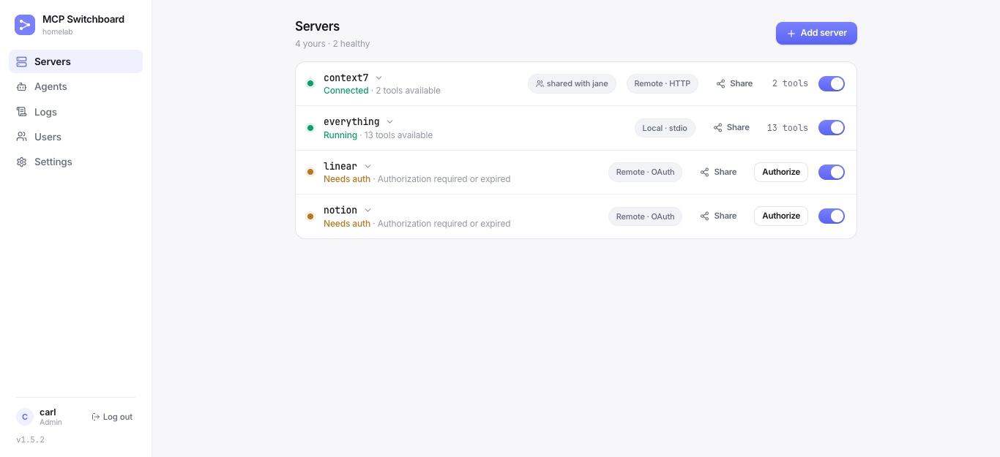
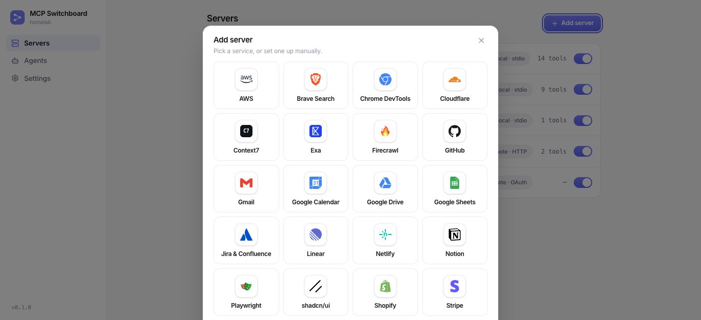
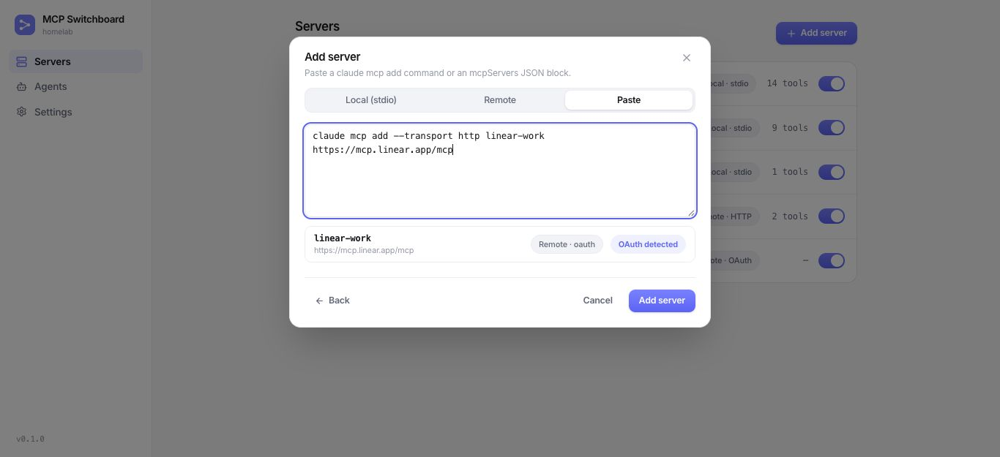
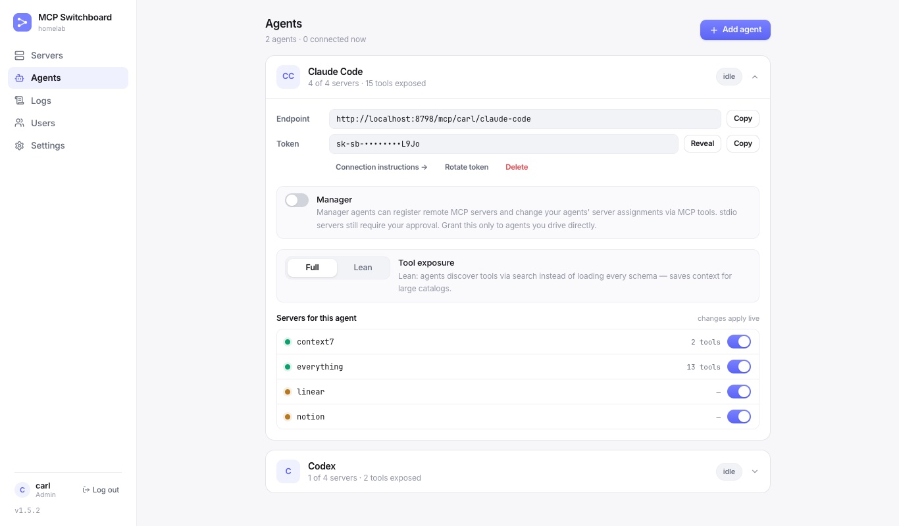
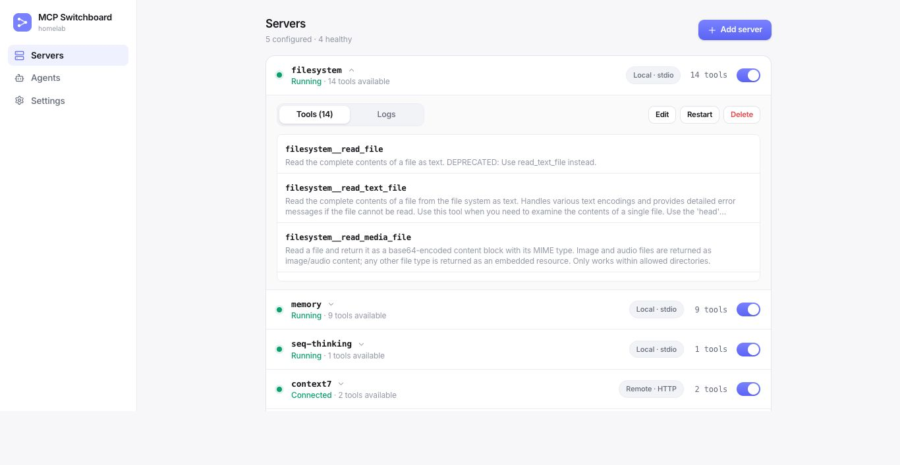
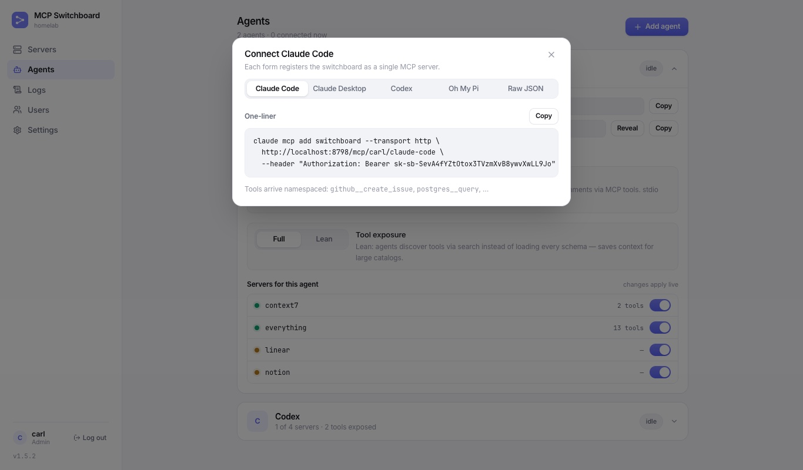
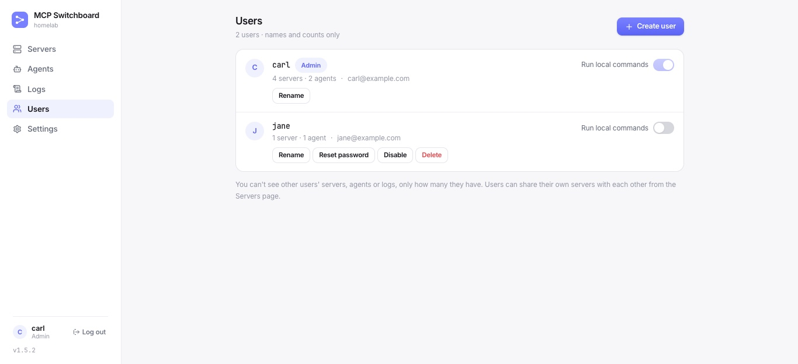
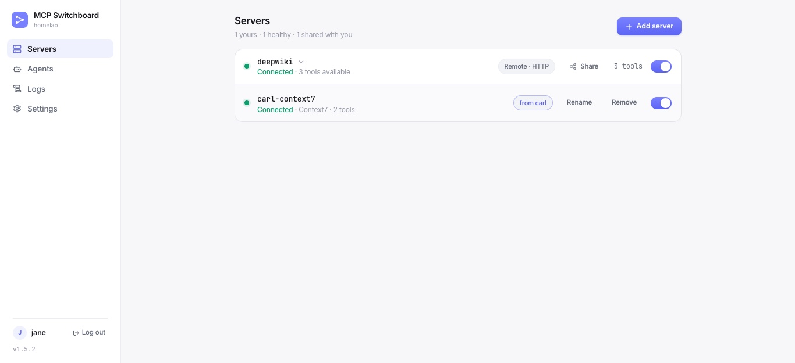
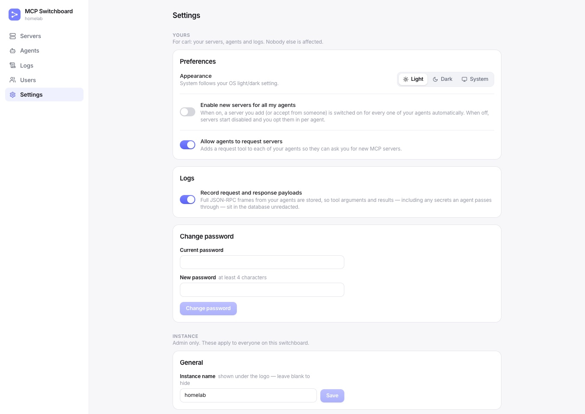

# MCP Switchboard

A small self-hosted switchboard for MCP: put all your MCP servers in one place and hand each of your coding agents (Claude Code, Codex, …) its own endpoint with exactly the servers you want it to see.



- **One-click templates** — add 20+ popular servers (GitHub, Linear, Notion, Stripe, Cloudflare, Supabase, Playwright, Context7, …) from a visual picker. OAuth servers go straight to the consent page; the rest ask only for the API key they need.
- **Local and remote servers** — stdio processes (`npx …`, `uvx …`) supervised by the switchboard, or remote Streamable HTTP / SSE servers with bearer-token, custom-header or full OAuth 2.1 auth. Secrets are encrypted at rest and OAuth tokens refresh in the background.
- **Per-agent switch matrix** — turn each server on or off per agent; changes apply live, no agent restart.
- **Paste to import** — paste a `claude mcp add …` command or an `mcpServers` JSON block and review it before it is created.
- **Namespaced tools** — `github__create_issue`, `google-work__gmail_search`. Several accounts of one service are just several servers with different names, and server descriptions tell agents which is which.
- **[Lean mode](docs/lean-mode.md)** — give an agent three search/describe/call tools instead of hundreds of tool schemas.
- **Request logs** — every request an agent sent and the response it got, filterable and live, kept 48 hours by default.
- **Household-ready** — separate users, each fully isolated, with optional sharing of a server's live connection. Built for a trusted home or office network, not the public internet.

| Add from a template | Paste to import (auth auto-detected) |
| --- | --- |
|  |  |



| Tools & logs per server | One-click agent onboarding |
| --- | --- |
|  |  |

## Quick start

Requires Node 20+, or Docker.

```bash
npx @cmer/mcp-switchboard          # http://localhost:8787
```

```bash
docker compose up -d --build       # http://localhost:8787, state in ./data
```

On first visit, set the password for the `admin` user. State lives in `~/.config/mcp-switchboard`
(`./data` with Docker), so back that directory up. To reach the switchboard from another machine, set
`PUBLIC_URL` to the address you'll open it at; see [Configuration](docs/configuration.md) and
[Reverse proxies and HTTPS](docs/reverse-proxy.md). From source: `npm install && npm run build && npm start`.

## Connecting an agent

Create an agent in the UI and copy the connection snippet it shows. For Claude Code:

```bash
claude mcp add switchboard --transport http \
  http://<switchboard-host>:8787/mcp/<username>/<agent> \
  --header "Authorization: Bearer <agent-token>"
```

Upgrading from 1.x? Your old `/mcp/<agent>` URLs and tokens keep working; new snippets show
`/mcp/admin/<agent>`.

Claude Desktop and claude.ai connectors can't send a header. They sign in over OAuth with a one-time
pairing code instead, and need the endpoint reachable over public HTTPS. See the
[Claude Desktop guide](docs/claude-desktop.md).

## Users and sharing



The `admin` user (the Admin) creates other users from the **Users** page and gets a one-time setup
code for each. The new person enters the code on the login page and picks their own password, so the
Admin never learns it. Each user's servers, agents, logs and settings are private to them; the Admin
sees only names and counts.

**Share** a server and the recipient can accept it under an alias of their choice. Their agents then use
your connection and your credentials; they never see the URL, command, headers or logs. You can see how
often each person uses it, and revoke it at any time.



Adding a **local command** (stdio) server runs code on the host, so it needs the Admin's per-user "can
run local commands" permission. Without it, a request goes to the Admin to approve. Treat the permission
as full trust: a local command can read `secret.key`, so a user who has it can read every secret on the
host. This is a household model, not protection from a hostile user.



To sign in through Cloudflare Access instead of passwords, see [that guide](docs/cloudflare-access.md).

## Guides

- [Configuration](docs/configuration.md): environment variables, data directory, backups
- [Reverse proxies and HTTPS](docs/reverse-proxy.md): `PUBLIC_URL`, OAuth over plain HTTP, the separate agent port
- [Claude Desktop and claude.ai](docs/claude-desktop.md): connect OAuth-only clients
- [Cloudflare Access](docs/cloudflare-access.md): sign in with Cloudflare instead of passwords
- [Recovering access](docs/recovering-access.md): reset a password or switch back to password login from the host
- [Lean mode](docs/lean-mode.md): a constant-size tool surface for agents with large catalogs
- [Changelog](CHANGELOG.md), including how to upgrade from 1.x
